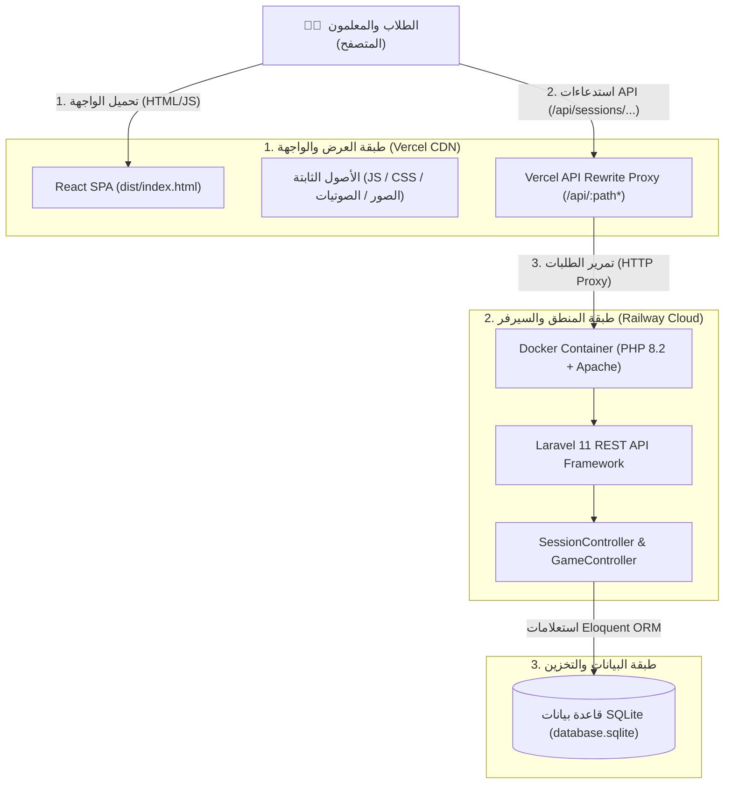
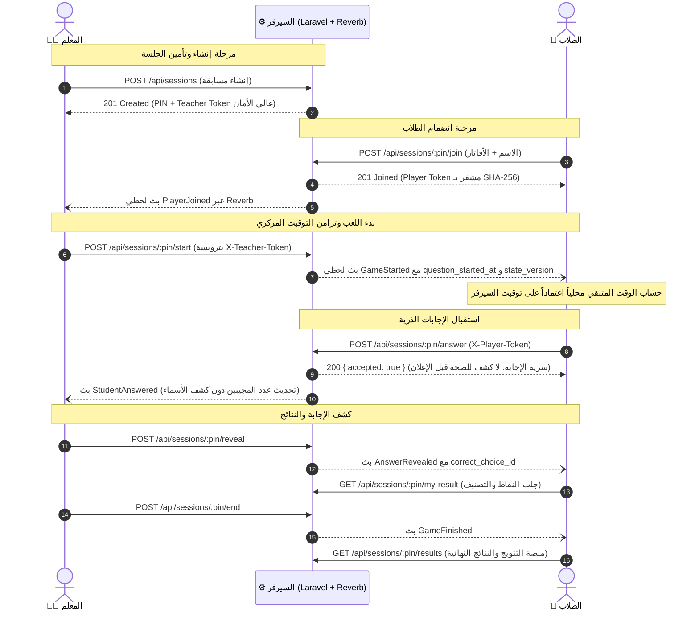
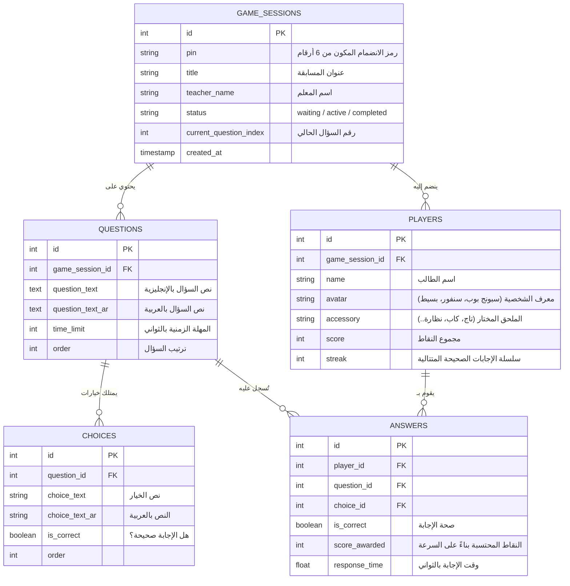
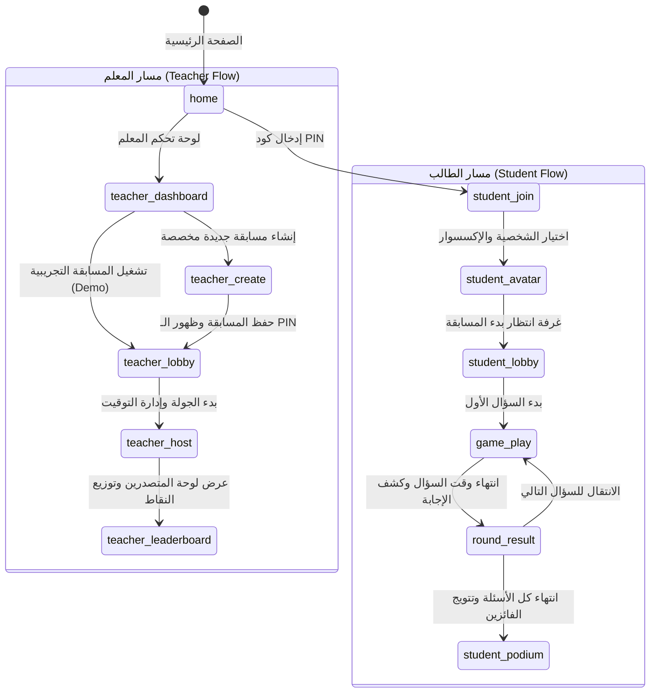

# 🏛️ معمارية مشروع Tecorbi Kids Arena (Architecture Document)

> توثيق معماري شامل لمنصة المسابقات التفاعلية للأطفال **Tecorbi Kids Arena**. يشرح هذا المستند بنية النظام، تقسيم الاستضافة، تدفق البيانات بين الواجهة والسيرفر، ومخطط قاعدة البيانات ومكونات التطبيق.

---

## 1. نظرة عامة على النظام (High-Level Architecture)

يعتمد المشروع على أسلوب **Decoupled Architecture (فصل الواجهة عن السيرفر)** لتقليل التكلفة للصفر والاستفادة من السرعة العالية للواجهات الثابتة مع مرونة خادم الـ API:



---

## 2. تفاصيل البنية التحتية (Infrastructure & Deployment)

| المكون | المنصة (Platform) | الوظيفة | الرابط المباشر |
| :--- | :--- | :--- | :--- |
| **Frontend SPA** | **Vercel** | استضافة واجهة React المبنية عبر `dist/` وتوجيه طلبات الـ API | [https://dist-seven-rouge-28.vercel.app](https://dist-seven-rouge-28.vercel.app) |
| **Backend API** | **Railway** | تشغيل بيئة Docker تحتوي على Laravel 11، معالجة الجلسات والأسئلة | [https://game-2-production-55c99ce0.up.railway.app](https://game-2-production-55c99ce0.up.railway.app) |
| **Database** | **Railway (Embedded)** | قاعدة بيانات SQLite محلية مدمجة وسريعة الاستجابة | مدمجة داخل الحاوية |

### آلية عمل `dist/` و Vercel Proxy:
1. عند تشغيل أمر البناء `npm run build`:
   - يقوم **Vite** بترجمة وضغط أكواد React والـ CSS إلى `public/build/assets/`.
   - يقوم سكربت `scripts/prepare-dist.js` بنسخ ملفات البناء، الصور، نماذج 3D، والصوتيات إلى مجلد `dist/`.
   - يقوم السكربت بإنشاء ملف `dist/vercel.json` يحتوي على قواعد التوجيه:
     ```json
     {
       "rewrites": [
         { "source": "/api/:path*", "destination": "https://game-2-production-55c99ce0.up.railway.app/api/:path*" },
         { "source": "/(.*)", "destination": "/index.html" }
       ]
     }
     ```
2. بفضل هذا الـ Proxy، يتصل المتصفح بـ `/api/...` كأنه على نفس النطاق، مما يمنع مشاكل CORS بالكامل ويسرع المعالجة.

---

## 3. دورة حياة المسابقة والاتصال اللحظي (Real-time & Timer Synchronization)

يعتمد التطبيق على معمارية هجينة للاتصال اللحظي تجمع بين **Laravel Reverb WebSockets** كقناة رئيسية سريعة، و**Adaptive Smart Polling** كقناة بديلة تضمن استمرارية اللعب بنسبة 100%:



### الأمان وتكامل البيانات (Security & Integrity Hardening):
1. **مصادقة المعلم والطلاب (Token-based Auth):** يتم تخزين `teacher_token_hash` و `token_hash` بتشفير SHA-256. التوكن لا يمر عبر روابط URL أو معاملات Query String، بل عبر ترويسات `X-Teacher-Token` و `X-Player-Token`.
2. **سرية الإجابات (Answer Secrecy):** استدعاء `/answer` يرد بـ `{ accepted: true }` فقط. نقطة نهاية `/my-result` و `/results` محمية برمز HTTP 409 `NOT_REVEALED` / `NOT_COMPLETED` حتى يضغط المعلم زر الكشف أو تنتهي المسابقة.
3. **التحديث الذري والمنع التكراري (Atomic Scoring & Concurrency):** منع السباق في النقاط والـ streak عبر قيود فريدة `unique(['player_id', 'question_id'])` و `increment` الذري. الإجابات المكررة ترد برمز 409 `ALREADY_ANSWERED` دون تصفير اختيار الطالب.
4. **استعادة الاتصال (Reconnection / Self-Healing):** في حال انقطاع الشبكة أو إعادة تحميل الصفحة، يتصل العميل بـ `GET /api/sessions/:pin/me` بالتوكن المخزن لاستعادة حالة الطالب والعودة فوراً لشاشة اللعب أو غرفة الانتظار.

---

## 4. مخطط قاعدة البيانات (Entity Relationship Diagram - ERD)

تعتمد البيانات على 5 جداول رئيسية مترابطة في Laravel:



---

## 5. هيكلية الواجهة الأمامية وحالات الشاشات (Frontend State Machine)

تتم إدارة حالة التطبيق في ملف `resources/js/app.jsx` كـ Single Page Application (SPA) تعتمد على نمط الـ State Machine عبر متغير `mode`:



---

## 6. الدليل الهيكلي للملفات (Project Directory Structure)

```text
game 2/
├── app/                        # ⚙️ كود Laravel الخلفي (Controllers & Models)
│   ├── Http/Controllers/
│   │   ├── SessionController.php   # إنشاء الجلسات، الغرف، والتحكم اللحظي
│   │   └── GameController.php      # استقبال الإجابات، حساب النقاط، والتصنيف
│   └── Models/                     # نماذج Eloquent (GameSession, Question, Player...)
├── database/                   # 🗄️ الميجريشن والبيانات الأولية
│   ├── migrations/                 # جداول قاعدة البيانات
│   ├── seeders/DatabaseSeeder.php  # السيشن التجريبي الافتراضي (PIN: 123456)
│   └── database.sqlite             # ملف قاعدة البيانات
├── routes/
│   └── api.php                     # 🔌 جميع مسارات الـ REST API
├── resources/                  # 💻 كود المصدر للواجهة
│   ├── js/
│   │   ├── app.jsx                 # العقل المدبر للواجهة (2900+ سطر كود React)
│   │   └── components/             # المكونات الإضافية (Intro, 3D overlays...)
│   └── css/
│       └── app.css                 # تصميم الواجهة، الألوان، وأنيميشن البطاقات
├── public/                     # 🎨 الأصول الثابتة (صور الشخصيات، 3D models، أصوات)
│   └── images/avatars/             # صور سبونج بوب، سنفور، وبسيط
├── scripts/
│   └── prepare-dist.js         # 🛠️ معالج ومجهز حزمة Vercel التلقائي
├── dist/                       # 📦 المجلد الناتج المرفوع على Vercel
│   ├── index.html
│   ├── vercel.json                 # إعدادات الـ API Proxy وتوجيه الروابط
│   └── assets/                     # ملفات JS و CSS المضغوطة للإنتاج
├── Dockerfile                  # 🐳 ملف بناء وتوزيع السيرفر على Railway
├── vite.config.js              # ⚡ إعدادات Vite للبناء السريع
└── package.json                # التبعيات والـ scripts
```

---

## 7. مفاتيح تقنية مميزة في المشروع (Key Highlights)

1. **نظام الأفاتار الكرتوني الثنائي (Avatars & Accessories):**
   - اختيار الشخصية (سبونج بوب، سنفور، بسيط، أو إيموجي).
   - انتقال فوري للشاشة المقربة (Close-up View) لاختيار الملحق (طاقية، نظارة، تاج.. إلخ).
   - صور الأفاتار كرتونية خفيفة وثابتة مصممة خصيصاً لتناسب سرعة أجهزة الهواتف والأطفال.
2. **الـ Fallback التلقائي للجلسات التجريبية (Self-Healing Demo):**
   - في حال تم إعادة تشغيل حاوية السيرفر وفقدان جلسة `123456` من الـ SQLite المؤقت، يحتوي كود React على آلية ذكية تستشعر خطأ 404 وتقوم فوراً وبشكل صامت بإنشاء جلسة تجريبية غنية بالأسئلة العلمية والرياضية دون أي انقطاع للمستخدم.
3. **نظام الصوتيات التفاعلي (Sound FX Engine):**
   - مدمج بمكتبة Web Audio API لتشغيل مؤثرات للأزرار، العد التنازلي، الإجابات الصحيحة والخاطئة، واحتفالات الفوز (Confetti).
